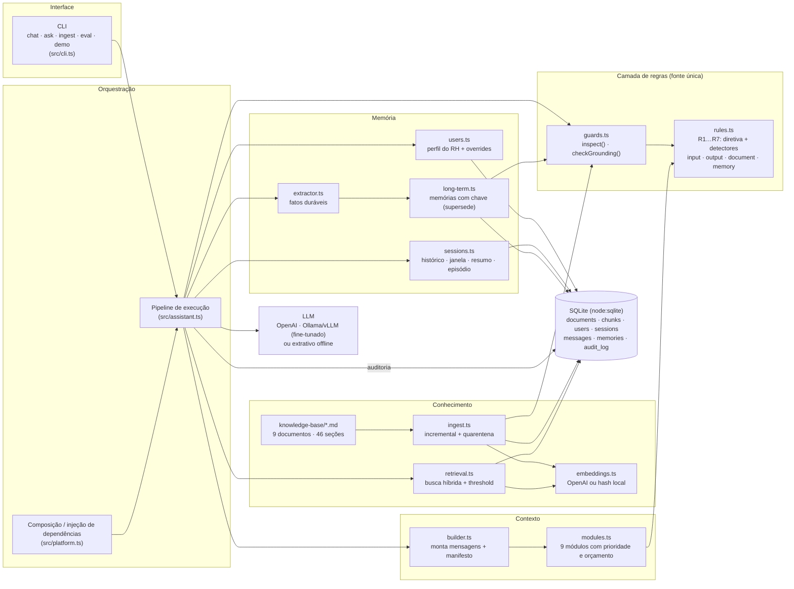
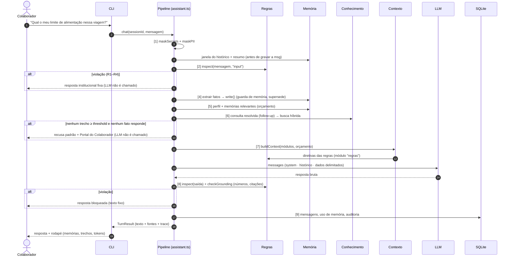

# Arquitetura do sistema

## Visão geral

A plataforma é um **assistente conversacional com estado** para colaboradores da Lumora Tecnologia (empresa fictícia).
Ele responde sobre políticas, benefícios, processos, onboarding e suporte de TI. Saímos de chamadas isoladas de API para
um sistema com quatro capacidades separadas, cada uma com seu módulo e seus dados:

| Capacidade | Pergunta que responde | Onde está |
|---|---|---|
| **Contexto** | O que o modelo vê, em que ordem e com quanto espaço? | [src/context/](../src/context/) |
| **Memória** | O que eu já sei deste colaborador e desta conversa? | [src/memory/](../src/memory/) |
| **Regras** | O que nunca pode acontecer, seja qual for o modelo? | [src/rules/](../src/rules/) |
| **Conhecimento** | Qual documento oficial responde, e com que confiança? | [src/knowledge/](../src/knowledge/) |

O pipeline em [src/assistant.ts](../src/assistant.ts) só orquestra essas quatro peças. Ele não tem regra de negócio
própria.

## Diagrama de componentes



### Separação de responsabilidades

As dependências seguem uma direção única. Nenhuma camada de baixo conhece o pipeline.

```text
rules/  ←  knowledge/ (quarentena)  ←┐
rules/  ←  memory/    (guarda)      ←┤
rules/  ←  context/   (diretivas)   ←┼── assistant.ts ←── cli.ts / eval/
                                      │        ↑
                          platform.ts ┘ (cria e injeta db, embedder, llm, stores)
```

- Para **mudar uma política**, edita-se só [rules.ts](../src/rules/rules.ts). O system prompt (módulo `regras`), as guardas
  de entrada/saída, a quarentena de documentos e o filtro de memória se atualizam juntos.
- Para **trocar o LLM**, troca-se o `LlmProvider` (OpenAI, servidor local com o modelo fine-tunado, extrativo, ou um modelo
  roteirizado nos testes). Nada mais muda.
- Para **trocar o banco vetorial**, troca-se `KnowledgeIndex`. A interface `search(embedder, query, options)` continua
  a mesma.
- Para **acrescentar uma peça ao contexto**, cria-se um `ContextModule` com prioridade e orçamento. O builder não muda.

## Interface de entrada

**CLI** (`node:readline`) com dois modos:

- `npm run chat -- --user U-002`: conversa interativa com sessão, comandos de memória (`/memorias`, `/lembrar`,
  `/esquecer`), sessões (`/sessoes`, `/retomar`, `/nova`) e inspeção (`/contexto`, `/debug`).
- `npm run ask -- --user U-002 "…"` / `--session <id>`: um turno por chamada, útil em scripts. Pode retomar qualquer
  sessão pelo id.

O pipeline recebe `(platform, sessionId, mensagem)` e devolve `TurnResult` (texto, desfecho, regra, fontes e trace
completo). Por isso, uma interface HTTP seria um adaptador fino de ~30 linhas sobre a mesma função `chat()`.

## Tecnologias e justificativas

| Componente | Escolha | Por quê |
|---|---|---|
| Linguagem/runtime | **TypeScript no Node 24** (execução direta de `.ts`) | Mesmo padrão dos projetos anteriores do módulo, sem etapa de build e com tipagem estrita (`tsc --noEmit`). |
| SDK de LLM | **`fetch` nativo contra `/chat/completions`** | Uma única integração atende OpenAI, Ollama, vLLM e llama.cpp. Assim o modelo fine-tunado do projeto `corporate-knowledge-finetune-cli` entra só por configuração (`LLM_BASE_URL`). Inclui retry com backoff para 429/5xx. Zero dependências de runtime. |
| Modelo base | **`gpt-5-mini`** (padrão) ou **Qwen2.5-1.5B + LoRA** servido localmente | O `gpt-5-mini` segue bem instruções longas de formato e citação, a custo baixo. A alternativa local mantém os documentos internos dentro da empresa. Ver [decisao-customizacao.md](decisao-customizacao.md). |
| Modelo de embedding | **`text-embedding-3-small`** (1536 dims) ou **hash local** (1024 dims) | O `text-embedding-3-small` é barato e forte em português para textos curtos. O embedder local (radicais + trigramas, *hashing trick*) deixa tudo rodando offline e de forma determinística nos testes. O índice registra qual embedder foi usado e reindexa sozinho se ele mudar. |
| Banco de dados | **SQLite via `node:sqlite`** (um arquivo, WAL) | Conhecimento, memória, sessões e auditoria ficam num só lugar, com transações e sem servidor. Para um assistente interno com dezenas de milhares de mensagens, é suficiente e simples de operar. |
| "Banco vetorial" | **Vetores Float32 em BLOB + cosseno em memória** | 46 seções cabem em microssegundos de busca exaustiva. A recuperação é exata (sem aproximação de ANN) e não há infraestrutura extra. Com mais de ~50 mil trechos, a troca natural é `sqlite-vec` ou pgvector, atrás da mesma interface `KnowledgeIndex`. |
| Busca | **Híbrida**: 0,5·cosseno + 0,5·cobertura lexical (IDF) | O vetorial pega paráfrases; o lexical pega números, siglas e nomes ("Despesas+", "SLA"). Termos que não existem na base derrubam a cobertura, o que torna o threshold um bom detector de pergunta fora da base. |
| Testes | **`node:test`** + cenários conversacionais | Os mesmos 40 cenários alimentam `npm test` e o relatório `npm run eval`. |

## Fluxo de uma requisição, do início ao fim



As setas tracejadas de "alt" são **saídas antecipadas**. Na avaliação, 17 dos 47 turnos terminaram sem chamar o LLM:
bloqueios, recusas fora da base, small talk e atualizações de memória. Isso economiza custo e elimina toda uma classe de
alucinação.

Um exemplo real, com o contexto completo e o `--debug` de cada etapa, está em [demonstracao.md](demonstracao.md).
